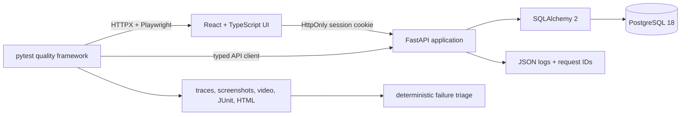
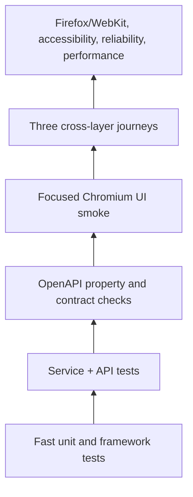
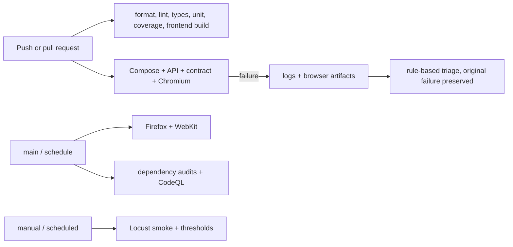

# ShiftBridge Quality Engineering Lab

ShiftBridge is a fictional hospitality workforce marketplace surrounded by a production-minded
quality platform. The React/FastAPI application is deliberately compact; the primary portfolio
product is the reusable Python automation framework that validates UI, API, service, contract,
accessibility, failure, authorization, concurrency, and performance behavior.

No Paathz branding, real company endpoints, scraped content, private APIs, or production data are
used.

## Why this is relevant to QA and SDET roles

The repository demonstrates framework design from near zero, testability-conscious application
engineering, API-based setup, concurrency-safe data, server-side authorization, deterministic
failure injection, useful artifacts, rule-based failure triage, container health, and focused CI
quality gates. Tests are separated from the system under test and are designed to explain a
failure instead of merely reporting one.

## Product features

- Candidate registration, login/logout, job search, filtering, details, applications, and history
- Employer job creation, owned-job views, and applicant lists
- Server-enforced candidate/employer permissions and employer ownership
- Database-level duplicate-application protection with a deterministic conflict response
- Pagination, normalization, validation, inactive-job behavior, and consistent problem details
- Request IDs, structured JSON logging, liveness/readiness probes, and safe deterministic seeds
- Responsive, semantic React pages with loading, empty, validation, auth, server, and network states

## Architecture



The web container serves static Vite output and proxies `/api` to FastAPI. Alembic owns schema
changes; a development/test-only CLI seeds fictional accounts and jobs. See
[`docs/ARCHITECTURE.md`](docs/ARCHITECTURE.md) for the full data and fixture design.

## Testing pyramid



The suite spends most execution time below the browser. Chromium smoke is the pull-request UI
gate; Firefox and WebKit run on `main`, on schedule, and manually.

## Repository structure

```text
apps/api/                 FastAPI source, Alembic migrations, backend tests
apps/web/                 React/Vite source and frontend unit tests
qa/src/shiftbridge_qa/    reusable typed QA framework
qa/tests/                 unit, API, contract, UI, E2E, reliability and a11y suites
qa/performance/           Locust behaviors and profiles
infra/                    container/runtime support
scripts/                  cross-platform orchestration and quality helpers
docs/                     strategy, architecture, traceability and ADRs
.github/workflows/        quality, integration, cross-browser, performance, security
compose.yaml              local production-like stack
pyproject.toml / uv.lock  exact Python dependency graph
```

## Technology choices and resolved versions

The lockfiles are the source of truth. The project baseline is Python 3.13 (CI/Docker
`3.13.14`), Node.js `24.18.0` LTS, npm `11.16.0`, PostgreSQL `18.4`, FastAPI `0.141.0`,
SQLAlchemy `2.0.51`, Pydantic `2.13.4`, React `19.2.8`, Vite `8.1.5`, Playwright `1.61.0`,
pytest `9.1.1`, Schemathesis `4.24.3`, Locust `2.46.2`, Ruff `0.16.0`, and mypy `2.3.0`.
`uv.lock` and `apps/web/package-lock.json` pin transitives exactly.

## Quick start

Prerequisites are Docker Desktop with Compose, Python 3.13+, and Node 24 LTS.

Linux/macOS:

```bash
cp .env.example .env
python -m pip install uv==0.12.0
make setup
make app-up
```

Windows PowerShell:

```powershell
Copy-Item .env.example .env
python -m pip install uv==0.12.0
.\scripts\bootstrap.ps1
.\scripts\start-stack.ps1
```

Open `http://localhost:4173`. The API documentation is at
`http://localhost:8000/docs`; probes are `/health/live` and `/health/ready`.

## Demo credentials

All identities are fictional and local:

| Role | Email | Password |
|---|---|---|
| Candidate | `candidate@shiftbridge.test` | `ShiftBridge-Demo-2026!` |
| Employer A | `employer.a@shiftbridge.test` | `ShiftBridge-Demo-2026!` |
| Employer B | `employer.b@shiftbridge.test` | `ShiftBridge-Demo-2026!` |

Never reuse these values outside this lab.

## Local commands

| Command | Purpose |
|---|---|
| `make setup` | sync locked Python/Node packages and install Chromium |
| `make app-up` / `make app-down` | build, health-check, and stop the stack |
| `make app-reset` | safely rebuild deterministic non-production data |
| `make lint` / `make format` / `make typecheck` | static quality |
| `make test-unit` / `test-api` / `test-contract` | fast lower-layer suites |
| `make test-smoke` / `test-ui` / `test-e2e` | browser suites |
| `make test-accessibility` / `test-reliability` | focused specialist suites |
| `make test-cross-browser` | Chromium, Firefox, and WebKit smoke |
| `make perf-smoke` | laptop-safe Locust run plus threshold gate |
| `make report` | deterministic failure triage |
| `make test-all` / `make clean` | complete regression / generated cleanup |

On Windows, the corresponding scripts live in `scripts/*.ps1`; `npm.cmd` is used so restricted
PowerShell execution policies do not invoke `npm.ps1`.

## Test suites

- Backend unit/service tests cover hashing, roles, filters, paging, ownership, inactive jobs,
  problem generation, and duplicate conflicts.
- QA framework unit tests cover config validation, reproducible factories, parsing, redaction,
  signature normalization, grouping, and threshold decisions.
- API tests cover health, auth, validation, filtering, paging, authorization, data exposure,
  mass assignment, unknown/invalid IDs, unexpected fields, duplicate and concurrent applications.
- Schemathesis and Hypothesis exercise schema conformance and bounded/generated inputs.
- UI smoke covers the 14 portfolio-critical browser behaviors; E2E verifies postconditions through
  both UI and API.
- Reliability tests intercept delayed, failed, aborted, expired, hostile, and duplicate requests.
- Accessibility combines keyboard behavior, semantic assertions, and locally installed axe-core.

The scenario-to-file mapping is in [`docs/TEST_CASES.md`](docs/TEST_CASES.md).

## Cross-browser policy

Chromium runs on every pull request because it gives fast feedback for the highest-value journeys.
Firefox and WebKit run after changes reach `main`, twice weekly, and on demand. One mobile and one
desktop viewport cover navigation and primary actions without pretending to offer pixel-perfect
visual certification.

## Failure artifacts

Failed browser cases retain a Playwright trace, screenshot, and video where practical, plus
console errors and failed-request metadata. Runs also emit JUnit XML, self-contained pytest HTML,
coverage XML/HTML, contract reports, Locust CSV/HTML, and Compose logs. Paths are namespaced by
run ID, browser, and test node. Sensitive headers, cookies, passwords, tokens, and cover-note
contents are redacted.

Open a trace with:

```bash
uv run playwright show-trace artifacts/<run-id>/<browser>/<test>/trace.zip
```

Open HTML reports directly from `artifacts/pytest`, `htmlcov`, or `artifacts/performance`.

## Deterministic failure triage

`make report` reads JUnit, browser-console, HTTP-failure, and test-metadata artifacts. It normalizes
UUIDs, timestamps, ports, and line numbers; groups equivalent signatures; applies transparent
rules; and writes `triage-report.json` plus `triage-report.md`. Each result names the probable
layer, evidence, related artifacts, similar failures, first debugging action, and confidence.
This is deterministic rules—not machine learning. Its interface leaves room for a disabled,
optional LLM adapter without coupling test execution to an external service.

## CI pipeline



Workflow permissions are read-only unless CodeQL needs `security-events: write`. Superseded branch
runs are cancelled. Mandatory gates do not use `continue-on-error`; artifacts and teardown run
with `always()`.

## Performance testing

Locust models candidate browsing and application submission. The laptop smoke profile uses five
users for 30 seconds; CI is intentionally tiny; manual users, spawn rate, and duration are
configurable. Initial gates are failure rate below 1%, jobs-list p95 below 750 ms, and health p95
below 250 ms. These are regression-smoke thresholds, not fabricated capacity claims. GitHub-hosted
runner timings are noisy; formal capacity work requires a controlled environment and repeated runs.

## Security approach

The lab covers object- and function-level authorization, neutral authentication failures, excessive
data exposure, role mass assignment, invalid/oversized input, safe text rendering, exact CORS, and
duplicate actions. `security.yml` runs `pip-audit`, npm audit with an explicit high/critical
advisory policy, and CodeQL. Dependabot monitors Python, npm, Docker, and Actions dependencies. See
[`SECURITY.md`](SECURITY.md) for the single reviewed RSC-only React Router advisory.

## Screenshots

Validated screenshots are stored in `docs/images` after the local stack is rendered:

- Job discovery at desktop width
- Employer dashboard and applicant workflow

They are generated from the fictional seeded environment; no personal or production data appears.

## Known limitations

- This is a local portfolio MVP, not a multi-tenant production marketplace.
- Sessions are short-lived signed cookies; there is no password reset, MFA, email delivery, or admin UI.
- The scheduled cross-browser workflow has not run until this code is hosted on GitHub.
- Locust thresholds detect large regressions but do not establish production capacity.
- Automated accessibility checks complement rather than replace a manual assistive-technology review.

## Roadmap

After the mandatory gates remain stable: deterministic screenshot comparisons for two pages,
mutation testing for application eligibility, changed-path test selection, and an optional
disabled-by-default LLM triage adapter.

## Résumé-ready summary

Built ShiftBridge, a self-contained React/FastAPI/PostgreSQL workforce marketplace, and a typed
pytest/Playwright quality platform covering unit, API, OpenAPI property, cross-browser UI, E2E,
accessibility, reliability, security, concurrency, and Locust performance tests. Implemented
request-correlated diagnostics, failure artifacts and deterministic triage; enforced strict typing,
branch coverage, container health, dependency scanning, and risk-based GitHub Actions gates.

## Troubleshooting

- **Docker health timeout:** run `docker compose ps` and `docker compose logs --no-color`; readiness
  intentionally fails until PostgreSQL responds.
- **PowerShell blocks npm:** use `npm.cmd` or the provided `.ps1` scripts.
- **Browser executable missing:** run `uv run playwright install chromium` (or all three browsers).
- **Port already in use:** stop the owning local process or set documented Compose port overrides;
  do not point tests at an unknown environment.
- **Reset rejected:** reset is intentionally allowed only when `ENVIRONMENT` is `development` or
  `test`.
- **Configuration error:** start from `.env.example`; production URLs are never silent defaults.
