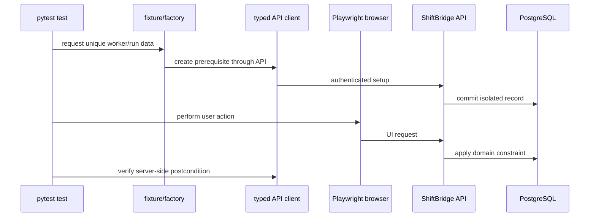

# Architecture

## Application

The Vite/React single-page client is served by a small non-root web container. It calls FastAPI
through a same-origin `/api` reverse proxy in Compose, so the browser never needs a production-like
cross-origin workaround. FastAPI owns validation, role authorization, ownership, and problem
translation. SQLAlchemy 2 maps users, jobs, and applications to PostgreSQL; Alembic versions the
schema.

The database enforces a unique `(candidate_id, job_id)` application pair. The service catches only
the expected integrity conflict, rolls back, and emits a stable `409` problem. UI button disabling
improves experience but is not the integrity boundary.

## Authentication

Registration accepts only the candidate role regardless of extra input. Passwords are Argon2
hashed. Login returns a short-lived signed token in an HttpOnly `SameSite=Lax` cookie; `Secure` is
environment-controlled and mandatory outside local HTTP. Each protected dependency verifies token
claims, current user, and role. Logout clears the cookie. Errors remain neutral.

## API error and observability flow

Every request receives or generates a request ID. Expected domain and validation failures are
serialized as problem details with code, title, status, detail, request ID, and optional field
errors. Middleware emits safe structured JSON containing method, normalized route, status,
duration, and environment. It never logs request bodies, cookies, tokens, password fields, or
cover notes.

Readiness executes a bounded `SELECT 1`; liveness only proves the process event loop is available.

## QA framework

`qa/src/shiftbridge_qa` is package code, not a collection of test-only helpers:

- `config` validates explicit safe environment settings.
- `api` provides typed domain operations and structured problem parsing.
- `data` creates reproducible worker/run-safe payloads.
- `pages` and `components` express user actions and meaningful state.
- `assertions` provides cross-layer domain assertions.
- `diagnostics` redacts, normalizes, groups, classifies, and renders artifacts.

Assertions live in tests or focused assertion helpers. Page objects do not wrap every Playwright
call and there is no catch-all base page.

## Fixture and data flow

API-based setup shortens browser tests and makes UI failures easier to localize. UI still exercises
authentication where authentication itself is the behavior under test.

## Parallelization

The run ID identifies the execution; `PYTEST_XDIST_WORKER` or configured worker ID identifies the
worker. Factory payloads include both plus a deterministic sequence/UUID fragment. Mutable data is
function-scoped. Parallel API and UI tests own their records. Only safe-environment reset/seed
operations are serial.

## Artifacts

Browser hooks collect console and failed-request records. On failure, metadata includes node ID,
browser, current URL/title, run ID, and supported screenshot/trace/video paths. Collection errors
are recorded without replacing the original exception. Redaction happens before persistence.

The triage CLI treats JUnit as the source of failed tests, augments it with browser/HTTP metadata,
normalizes volatile values, groups equivalent signatures, classifies probable layer, and renders
JSON/Markdown. An adapter interface permits a future optional summarizer but the default path is
offline deterministic rules.

## Deployment and container flow

Compose starts PostgreSQL, waits for its health, migrates/seeds through the API image, then starts
FastAPI and the static web server. Both application containers use unprivileged users and explicit
health checks. Only application ports are exposed locally; PostgreSQL stays on the named network.
The database volume is persistent until an explicit reset/down-with-volumes operation.

## Tradeoffs

- Signed short-lived cookies avoid local storage and keep the demo self-contained; a production
  system would usually add revocation/rotation and an external identity provider.
- A local fictional app creates deterministic, ethical test control; it is intentionally not a
  claim of production-scale product engineering.
- SQLite-compatible service code keeps unit tests quick while PostgreSQL remains the integration
  source of truth for constraints and concurrency.
- Chromium gates pull requests for feedback speed; scheduled engines cover browser-specific risk.
- Transparent deterministic triage is useful without network secrets, cost, or probabilistic CI.

